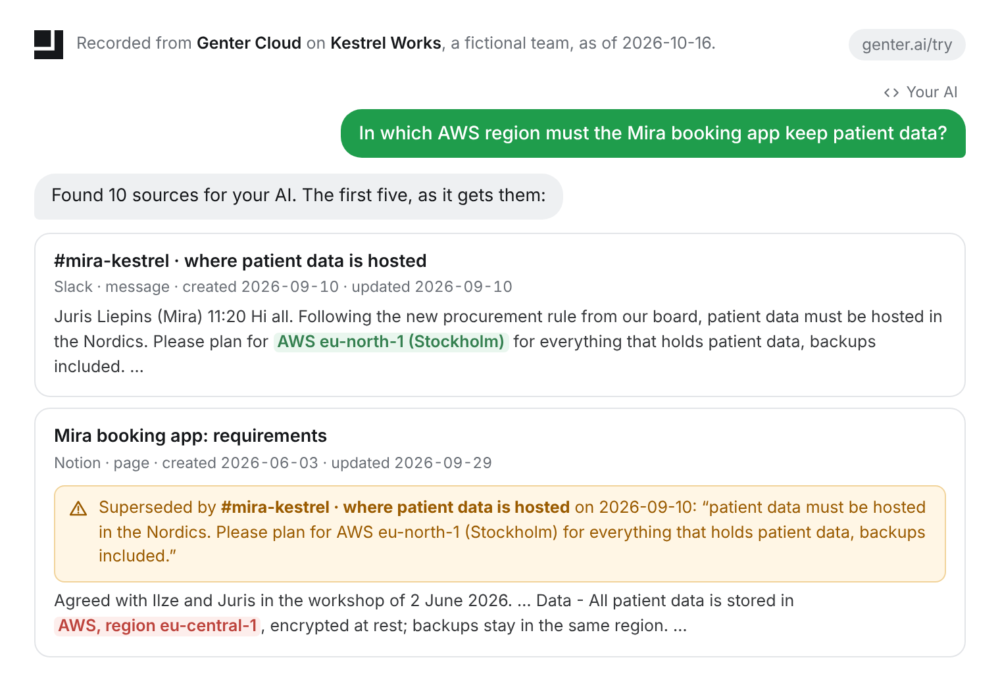

<p align="right"><b>English</b> · <a href="README.ru.md">Русский</a></p>

<p align="center">
  <a href="https://genter.ai/try"><picture>
    <source media="(prefers-color-scheme: dark)" srcset="docs/hero-dark.png">
    
  </picture></a>
</p>

<h1 align="center">Genter</h1>

<p align="center"><b>Your AI stops quoting the old answer.</b><br>
Genter shows your AI what your team decided, where it is written and when,<br>
and marks what was replaced since.</p>

<p align="center">
  <a href="https://genter.ai/try"><b>See it on a sample team</b></a> ·
  <a href="#add-genter-cloud-to-claude">Add to Claude</a> ·
  <a href="#add-genter-cloud-to-chatgpt">Add to ChatGPT</a> ·
  <a href="https://cursor.com/install-mcp?name=genter&config=eyJ0eXBlIjoic3RkaW8iLCJjb21tYW5kIjoibnB4IiwiYXJncyI6WyIteSIsImdlbnRlci1jbGkiLCJtY3AiXX0%3D">Add to Cursor</a> ·
  <a href="https://vscode.dev/redirect/mcp/install?name=genter&config=%7B%22type%22%3A%22stdio%22%2C%22command%22%3A%22npx%22%2C%22args%22%3A%5B%22-y%22%2C%22genter-cli%22%2C%22mcp%22%5D%7D">Install in VS Code</a> ·
  <a href="https://github.com/Genterai/genter/releases">Claude Desktop (.mcpb, next release)</a>
</p>

**The picture is Genter Cloud** on a fictional team, as the [try page](https://genter.ai/try) shows it with no sign-in:
the Notion page never says it was replaced, and finding the Slack thread that replaced it takes a model. **What needs
what:** with no key, Genter's open engine marks what a document says about itself (superseded, deprecated, an ADR's
status) and puts the current answer first. A contradiction nobody wrote down needs a model: Genter Cloud finds it today;
the open engine does not yet (planned: with your own key or Ollama).

## Your repository, no key

**The old-answer test.** 39 questions whose answer was replaced: 34 from public decision archives (Python's PEPs,
Kubernetes' KEPs, Jaeger's RFCs and ADRs) and 5 from [DriftBench](bench/drift). An agent's plain ranking leaves the
replaced document unmarked in its first five on 31 of 39 and puts it first on 8 of 39; Genter on 0 of 39 for both,
quoting the document's own notice each time. Genter puts the current answer first on 28 of 39 (plain ranking: 20 of 39),
the current answer being the document the question was written for or a later one the archive's own replacement marks
lead to; counted as written, that document alone, 27 of 39 (plain ranking: 20 of 39). Genter's first result differs from
plain ranking's on 10 of 39 questions, 9 of them among the 34 archive questions; on 11 of 39 both put another document
first, which may state the current answer too. Every question, what each arm put first, and the losses (0 counted with
the chain, 1 as written): [bench/old-answer/RESULTS.md](bench/old-answer/RESULTS.md) (the archive questions wait for a
person's review).

| of 39 questions ([results](bench/old-answer/RESULTS.md)) | plain ranking | Genter, no key |
| -- | --: | --: |
| old answer unmarked in the first five | 31 of 39 | **0 of 39** |
| old answer first | 8 of 39 | **0 of 39** |
| current answer first, with its chain | 20 of 39 | **28 of 39** |
| current answer first, as written | 20 of 39 | 27 of 39 |

Its 13 readers ([readers/](readers)) read what your documents say about themselves: ADRs; RFCs and RFDs (`rfc/`,
`rfcs/` and `rfd/` folders, Rust's `text/`); the improvement proposals of Python, Ethereum, NumPy, Kubernetes and Pulsar
(PEPs, EIPs and ERCs, NEPs, KEPs, PIPs); proposal and design folders (Swift Evolution, Go's design docs, Kotlin's
KEEP); a CHANGELOG's versions and deprecations; a `docs/decisions.md` log; a "Superseded by" or "Deprecated" notice at a
document's top; Obsidian front matter. Many repositories keep their records where no reader looks yet: of 46 popular
ones the readers were not written for, the median holds 0 records the readers read
([bench/repos/RESULTS.md](bench/repos/RESULTS.md)), and a reader is a JSON file anyone can add
([CONTRIBUTING.md](CONTRIBUTING.md)).

<p align="center"></p>

```bash
npx genter-cli demo        # offline, no key: the runbook above, before and after a newer doc replaces it
npx genter-cli install     # finds Claude Code, Claude Desktop, Cursor, VS Code, Codex, Gemini CLI, Zed, goose; shows each change, then asks
npx genter-cli decisions   # in a clone: a page of its decisions, current and replaced, by their own text
```

> **Until the next release:** npm has genter-cli 0.3.0, older than these three commands and than the server that
> `install` and the editor links add (`npx -y genter-cli mcp`). `npx -y github:Genterai/genter <command>` runs this
> repository as it is today.

<p align="center">Works with Claude · ChatGPT · Claude Code · Claude Desktop · Cursor · VS Code · Codex · Gemini CLI · Zed · goose · any MCP client</p>

<p align="center"><a href="https://www.npmjs.com/package/genter-cli">npm</a> · <a href="LICENSE">Apache-2.0</a> · 0 dependencies · <a href="STEWARDSHIP.md">no telemetry</a> · <a href="#benchmarks">DriftBench</a> · <b>English</b> | <a href="README.ru.md">Русский</a></p>

> The package is `genter-cli`. The npm package called `genter` belongs to someone else.

---

## Contents

[Genter Cloud](#genter-cloud-your-teams-apps) · [The local engine](#the-local-engine) ·
[Add it to your AI tools](#add-it-to-your-ai-tools) · [What it reads](#what-it-reads) ·
[The decisions page](#the-decisions-page) · [Benchmarks](#benchmarks) · [Ranking by meaning](#ranking-by-meaning) ·
[Each project searches its own](#each-project-searches-its-own) · [For a small team](#for-a-small-team) ·
[Your apps' own MCP servers](#your-apps-own-mcp-servers) · [In code](#in-code) · [Commands](#commands) ·
[More](#more)

## Genter Cloud: your team's apps

Why something works the way it does is rarely written in code. It is in a ticket, a Slack thread or an email.
[Genter Cloud](https://genter.ai) connects your apps (GitHub, Linear, Slack, Gmail, Notion, Google Drive and more), and
marks what a newer message, page or ticket replaced or went against, with a model. The
[try page](https://genter.ai/try) shows its recorded answers on Kestrel Works, a fictional team, with no sign-in.

It is its own MCP server, `https://genter.ai/api/mcp`, beside the local `genter mcp`. The AI tool signs you in with
OAuth the first time; genter-cli never calls Genter Cloud and keeps nothing on your disk for it (the first command
removes the token 0.3's `genter login` kept). Your agent then has the same two tools from each, `search` and `read`:
`genter` for your folders and `genter-cloud` for your apps, each with the places it cites and its marks in the same
format.

### Add Genter Cloud to Claude

In Claude (web, desktop or mobile): [Customize › Connectors](https://claude.ai/customize/connectors) › **Add custom
connector**, paste `https://genter.ai/api/mcp`, then **Add**; Claude signs you in to Genter. On Claude's Free plan you
can add one custom connector ([Claude's guide](https://claude.com/docs/connectors/custom/add-unlisted)). In Claude Code:

```bash
claude mcp add --transport http genter-cloud https://genter.ai/api/mcp
```

### Add Genter Cloud to ChatGPT

In ChatGPT: [Plugins](https://chatgpt.com/plugins) › **+** › **Add custom MCP server**, name it, choose the public
endpoint under Connection and paste `https://genter.ai/api/mcp`, choose OAuth, confirm, then **Create as a plugin**
([OpenAI's guide](https://developers.openai.com/apps-sdk/deploy/connect-chatgpt)). Your account's or workspace's
policies decide whether you can add one.

Cursor, VS Code and other clients that take a remote MCP server add the same address; `npx genter-cli install --cloud`
adds it to the tools on your computer that take one.

| | `genter-cli` | Genter Cloud |
| -- | -- | -- |
| Sources | folders, files, websites, notes, your apps' own MCP servers | your apps |
| Marks | what a document says about itself, no key | also what a newer message, page or ticket replaced or contradicts, found with a model |
| Kept current | read again at every question | every event in an app rechecks what it touches |
| Runs | on your computer | at genter.ai; your AI tool connects to it |
| Price | free, Apache-2.0 | see [genter.ai](https://genter.ai) |

## The local engine

**An MCP server, a command and a library that give your agent the place an answer is written.** Ask in your own words.
Genter returns the passages that answer, read just now, with the file and lines where each one is written, the date
the document gives itself, and its marks. There is no index to build and nothing to keep in sync, so there is no copy
to go stale. No dependencies, no server to run, and without an embeddings key nothing leaves your computer.

```bash
npx genter-cli demo                                    # 1. a decision is replaced, your AI gets the new one first: offline, no key
npx genter-cli ask "how do we deploy?"                 # 2. ask the folder you are in, ranked by words
npx genter-cli install                                 # 3. give it to your AI tools (it shows each change, then asks)
```

Your agent then has two tools, the same two as [Genter Cloud](#genter-cloud-your-teams-apps), both read-only:

| Tool | What it does |
| -- | -- |
| `search {query, limit}` | finds the passages that answer, reads them now, and returns each place with its id, `path:lines`, date and marks |
| `read {ids}` | reads places whole, as they are now, by the ids `search` returned, several at once |

```
[1] Release process v2 › Friday
  docs/release-process-v2.md:5-7 · file · updated 2026-10-03 · replaces [2]
    ## Friday

    No deploys on Fridays since October 3: deploy on Thursday.

[2] Release process › Friday
  docs/runbook.md:5-7 · file · updated 2026-10-20
  ⚠ superseded by [1] on 2026-10-03: “Deprecated: replaced by Release process v2”
    ## Friday

    Deploys go out on Fridays from the release branch.
```

The MCP contract is these two tools. Adding a folder, keeping a note and listing sources are commands (`genter add`,
`genter remember`, `genter sources`). The tools of 0.3 (`genter_find`, `genter_add`, `genter_remember`,
`genter_sources`) still answer, marked deprecated, until genter-cli 0.5.

## Add it to your AI tools

```bash
npx genter-cli install          # shows what it would add to each AI tool on this computer, then asks
npx genter-cli install --undo   # puts every file it changed back as it was
```

It finds Claude Code, Claude Desktop, Cursor, VS Code, Codex, Gemini CLI, Zed and goose, and adds
`npx -y genter-cli mcp` to each one's own settings for you, never to a project's files. Nothing is written until you
say yes, and nothing it writes is a token or a key. Genter searches the project of the folder a tool starts it in:
for VS Code the workspace, for Claude Code, Codex and Gemini CLI the folder you run them in (Cursor, Zed and goose do
not say which folder they use). Claude Desktop, which opens no project, searches your notes, or the folder you name
with `--folder`. `--cloud` also adds [Genter Cloud](#genter-cloud-your-teams-apps) where the tool takes a remote
server, `--semantic` turns on ranking by meaning, and `--dry-run` only shows. A copy of every file it changes is kept
in `~/.genter/install/`; `--undo` puts it back, or, if the tool has saved the file since, takes only Genter's entries
out of it.

The **Add to Cursor** and **Install in VS Code** links at the top add the same entry `install` writes for those two
editors (`npx -y genter-cli mcp`), through each editor's own install link.

### Claude Code

In Claude Code:

```
/plugin marketplace add Genterai/genter
/plugin install genter@genter
```

The plugin brings the local server and a skill. The server, `npx -y genter-cli@0.4 mcp`, searches the project Claude
Code runs in and your notes, with no key. The `genter` skill tells the agent when and how to use it: when it needs what
the project decided or how something works, it calls `search` first, cites the `[id]` and place each answer comes
from, repeats a mark as the quote Genter shows (never as its own verdict), and reads a place whole with `read`. The
server ranks by words; with `GENTER_SEMANTIC=1` and an embeddings key in the environment you start Claude Code from, it
ranks by meaning too.

> **The server needs genter-cli 0.4, which is not on npm yet.** 0.4 is published once npm trusted publishing is set up
> for this repository. The `genter-cli` on npm today, 0.3, is the old engine: its server has neither `search` nor
> `read`, so the plugin does not fall back to it. Until 0.4 is out, `/mcp` shows the plugin's server failing to
> connect. The skill already works with [Genter Cloud](#genter-cloud-your-teams-apps), which serves the same two
> tools, and the local server runs from a clone of this repository:
> `claude mcp add genter -- node <clone>/bin/genter.js mcp`.

The same marketplace lists [harden](#with-harden): `/plugin install harden@genter`. If you also added Genter with
`genter install`, Claude Code has two `genter` servers with the same tools: keep one (`/mcp` turns the plugin's off,
`claude mcp remove genter -s user` removes the other; `genter install --undo` would put back every tool's file).

**Search first at every prompt (optional).** The plugin runs no hook. To remind the agent at every prompt, add the
hook in [`plugins/genter/search-first.json`](plugins/genter/search-first.json) to `~/.claude/settings.json` (every
project) or `.claude/settings.json` (one project), next to any `hooks` already there. It only prints one line, which
Claude Code adds to your prompt: "Genter: before you answer what this project decided or how something works, call
search first, cite the [id] and place it returns, and repeat a mark as the quote Genter shows."

**Other agents.** The skill on its own: `npx skills add Genterai/genter` (Cursor, Codex, Gemini CLI and more), beside
the local server (`npx genter-cli install`, from 0.4) or Genter Cloud. `skills` is Vercel's command, not Genter's; it
sends anonymous usage data unless `DO_NOT_TRACK=1` is set.

### Other MCP clients

Any MCP client that starts a server over stdio:

```json
{ "mcpServers": { "genter": { "command": "npx", "args": ["-y", "genter-cli", "mcp", "."], "env": { "GENTER_SEMANTIC": "1" } } } }
```

### A repository the whole team works in

Commit two files, and every agent on the team asks Genter before it guesses:
[`examples/project/`](examples/project).

```bash
cd your-repo
curl -fsSLO https://raw.githubusercontent.com/Genterai/genter/main/examples/project/.mcp.json
curl -fsSL https://raw.githubusercontent.com/Genterai/genter/main/examples/project/AGENTS.md >> AGENTS.md
```

`.mcp.json` starts `genter-cli mcp .` for Claude Code with ranking by meaning on. It uses the first embeddings key the
person has set, and without one it ranks by words. `AGENTS.md` tells the agent to call Genter's `search` first and to
cite `path:lines`.

| | Without Genter | With Genter |
| -- | -- | -- |
| "where do we check who may see an invoice?" | the agent greps `invoice`, `permission`, `canView`… and reads ten files | one `search`, which returns 5 passages with `path:lines` |
| a question your docs answer | it reaches you | the agent answers it, citing the doc |
| a doc edited an hour ago | an index answers with the old text | the new text, marked *changed since the last look* |
| a page replaced by a newer one | both look equally true | the new one comes first, and the old page right after it, marked *superseded by [id]* with its own notice quoted |
| a decision made in chat | lost after the session | `genter remember`, found later with its date |

Starting a new project: write each decision where it is made (`docs/decisions.md`, one heading per decision, with a
date). When a page is replaced, mark the old one `> Deprecated: replaced by [v2](v2.md)`. Nothing needs to be
re-indexed as the project grows.

## What it reads

- Each file or page is an **Anchor**: one read with a fixed argument (`FILE_READ docs/deploy.md`). Genter keeps where
  it is, its headings, its dates and a digest of it, never a copy of its text.
- Every question reads the sources again. A changed file is answered from its new text, marked *changed since the last
  look*. A deleted file is *gone* and answers nothing. When a file of the project marks itself
  `Deprecated: replaced by [v2](v2.md)`, or names what replaces it by number (a PEP's `Superseded-By: 470`), and what
  replaces it is in the project too, that comes first and the marked file right after it, quoting its own notice; a
  mark from anywhere else shows on its place and moves nothing.
- A decision's date is the one its document gives (an ADR's `Date:`, a CHANGELOG heading, front matter). When a
  folder's files were all written within seconds (a fresh clone), their times say when the clone was made: Genter says
  *file dates unknown (fresh clone)* instead of using them.
- The 13 readers in [`readers/`](readers) read what a document says about itself: an ADR's date, status and
  "Superseded by" (in `adr/`, `adrs/`, `decisions/` and architecture-decision folders); the date, status and
  replacement of an RFC or an RFD (`rfc/`, `rfcs/` and `rfd/` folders, Rust's `text/`, Vue's `active-rfcs/`), of an
  improvement proposal (`peps/pep-*`, `EIPS/eip-*` and `ERCS/erc-*`, `neps/nep-*`, a KEP's `kep.yaml`, Pulsar's
  `pip/pip-*`) and of a document in a proposal or design folder (`proposals/`, `design/`, `enhancements/` and the like:
  Swift Evolution, Go's design docs, Kotlin's KEEP); a CHANGELOG's dated versions and what they deprecate or remove; a
  decision log's dated headings (`decisions.md`, `decision-log.md`); a "Superseded by" or "Deprecated" banner at a
  document's top; Obsidian front matter. They are data, never run, and anyone can add one
  ([CONTRIBUTING.md](CONTRIBUTING.md)); the phrases that mark a page as replaced are in [`rules/`](rules), English and
  Russian.
- Genter never reads hidden files, `.gitignore`d files, lockfiles, keys, or anything that holds a private key. Taking
  the docs in calls no model. Without an embeddings key, nothing leaves your computer.

## The decisions page

```bash
npx genter-cli decisions   # in a clone: ~/.genter/pages/<project>.html
```

One page of the project's decisions: each decision record a reader reads (an ADR, an RFC or RFD, a PEP, a KEP or another
proposal) and each heading of `docs/decisions.md`, current or replaced, with where it is written (`path:line`) and the
date the document gives itself. A replaced one quotes its own notice and names what replaces it; a document that says at
its top or in its front matter that it is replaced is listed too, with what it names. Every row is what a document says
about itself: no model, no key, no file dates, and no row says that two documents disagree (that needs a model).

```
Decisions in acme · generated at 3f2c1ab on 2026-10-20 · run `genter decisions` again to refresh
1 current · 1 replaced, by their own text · dates as the documents give them
CURRENT    Jobs run on Redis · Status: accepted   docs/adr/0011.md:3   2026-09-24
REPLACED   Jobs run on Postgres                   docs/adr/0003.md:3   2026-03-03
           docs/adr/0003.md:7 says: “Superseded by [ADR-0011](0011.md)” · replaced by docs/adr/0011.md
```

It quotes your documents, so it is written outside the repository, readable by you only (`--out <file>` puts it
elsewhere): check it before you share it. It is one HTML file with no script and nothing to load, so it opens offline,
and it is stamped with the commit it was made at, read from `.git` (Genter runs nothing, `git` included).

## Benchmarks

Every number here comes from a run of the open code in [`bench/`](bench), which anyone can repeat with no key and no
account. Genter Cloud's own numbers are not on this page.

**[The old-answer test](bench/old-answer)** asks 39 questions whose answer a newer document replaced and counts, for an
agent's plain ranking and for Genter over the same sections, how often the replaced document comes first or appears
unmarked in the first five, and how often the current answer comes first. The current answer is counted two ways: as
written, the document the question was written for; and with its chain, also any later document the archive's own marks
lead to (PEP 314 says "Superseded-By: 345", and PEP 345 "Superseded-By: 566"). The chain rule was set after a run in
which it changed one question, peps/0241: plain ranking puts first PEP 314, the document the question was written for,
and Genter PEP 566, the last of that chain, so counted as written that question is Genter's one loss. The table at the
top gives both counts, and [RESULTS.md](bench/old-answer/RESULTS.md) has every question, the losses and the plan's
decision rule. `node bench/old-answer/run.mjs` rebuilds it (it fetches the three archives at pinned commits with `git`).

**[The 50-repository gate](bench/repos)** runs the readers on popular repositories at pinned commits, in two samples.
The gate is judged on 46 held out, picked by the same written rule and committed before the readers ran on them: the
median holds 0 decision records the readers read, 9 of 46 hold 5 or more, and 20 of 46 hold at least one document with
a mark the readers read, so it does not pass (it needs a median of 5). On the first 50, which the readers were widened
looking at (a biased number, shown to compare), the median holds 1, 24 of 50 hold 5 or more and 30 of 50 a mark. The
records the readers miss are listed by repository ([RESULTS.md](bench/repos/RESULTS.md)). `node bench/repos/run.mjs`
rebuilds it.

**[DriftBench](bench/drift)** uses the docs of a 40-person company, 61 edits over two months, and the same 65 questions
asked before and after the edits, taking the top 5 passages. The run itself writes the tables below; they are not
written by hand.

<!-- driftbench:start -->
| | needs | before the edits | after the edits: current answer | after the edits: stale answer |
| -- | -- | -- | -- | -- |
| **genter** | nothing | 80% | **77%** (89% of the changed facts) | **0%** |
| an index built once, same ranking | nothing | 80% | 34% (11% of the changed facts) | 42% |
| **genter --semantic** | an embeddings key | 92% | **88%** (92% of the changed facts) | **0%** |
| an index built once + vectors | an embeddings key | 92% | 42% (8% of the changed facts) | 43% |
| a memory that extracts facts with a model, docs not added again | an LLM key, 34 packages, 277 LLM calls to take the docs in | 75% | 40% (11% of the changed facts) | 32% |
| the same memory, every edited file deleted from it and added again | an LLM key, 34 packages, 277 LLM calls to take the docs in, 320 more to add the edited files again | 75% | 75% (75% of the changed facts) | 3% |

**Over time.** The same 61 edits land one by one, 2 to 30 minutes apart; each of the 36 changed facts is asked again some time after its edit. An index re-synced every N minutes is genter's own search over a copy of the docs taken every N minutes. Current answer · stale answer (5 seeded timelines):

| time since the edit | 1 min | 5 min | 15 min | 30 min | 1 h | 2 h |
| -- | -- | -- | -- | -- | -- | -- |
| **genter**, reading the docs at each question | **89% · 0%** | **89% · 0%** | **89% · 0%** | **89% · 0%** | **89% · 0%** | **89% · 0%** |
| an index re-synced every 15 minutes, same ranking | 20% · 55% | 41% · 37% | 89% · 0% | 89% · 0% | 89% · 0% | 89% · 0% |
| an index re-synced every 60 minutes, same ranking | 13% · 69% | 18% · 64% | 29% · 52% | 54% · 30% | 89% · 0% | 89% · 0% |

**What it takes**, measured by `bench/drift/takes.mjs` (Node v22.22.0, linux x64). The store keeps each file's place, title, headings, dates, size and a digest of its text, sealed: 38155 bytes for 96396 bytes of docs.

| | **genter** | a memory that extracts facts with a model |
| -- | -- | -- |
| packages installed with it | **0** | 34 |
| model calls to take the docs in | **0** | 277 |
| network connections · servers started | **0 · 0** | a model provider's API on every add and search |
| from a cold start to the first answer (34 docs) | **184 ms** | 14 min to take the docs in |
| median search | **3 ms** | 288 ms |
| of the docs' text, it keeps | **0 of 1065 lines of body text (0 bytes); its headings** | 569 facts written by its model |

[Results, 2026-10-10](bench/drift/results/2026-10-10.md).
<!-- driftbench:end -->

**Reproduce it.** You need no key, no account and nothing to install. A fresh run on a GitHub runner every week
([bench.yml](.github/workflows/bench.yml)) fails if genter answers anything stale:

```bash
git clone https://github.com/Genterai/genter && cd genter
npm run bench                                         # the tables above, except the rows that need a key: ~30 s
node bench/drift/takes.mjs                            # what it takes, alone
```

**[LoCoMo and LongMemEval](bench/convo)** are the conversational-memory benchmarks. They measure whether the evidence
is among the passages Genter finds. Words only, no key, no model
([results, 2026-10-09](bench/convo/results/2026-10-09.md)).

| ([results](bench/convo/results/2026-10-09.md)) | questions | evidence in the top 5 | all of it in the top 5 | a search |
| -- | -- | -- | -- | -- |
| LoCoMo | 1,536 | 84.5% | 72.0% | 3 ms |
| LongMemEval-S | 470 | 96.6% | 82.3% (knowledge updates: 98.6%) | 110 ms |

This measures retrieval, which is Genter's own job. To judge answers with each benchmark's own prompt (the numbers
memory layers publish), run `node bench/convo/run.mjs --answer` with a key.

## Ranking by meaning

Ranking by words finds a question asked in the docs' own words. `--semantic` also ranks by meaning and fuses the two
rankings. On [DriftBench](bench/drift/results/2026-10-10.md), current answers go from 77% to 88%, and Russian questions
about English docs from 1 of 6 to 5 of 6. A passage is embedded once and its vector kept in the sealed store; later
questions embed only the question and what changed.

| | Words | **Meaning** (recommended for daily work) |
| -- | -- | -- |
| **Best for** | a quick look, an offline machine | an agent working in a repository every day |
| **Setup** | `npx genter-cli mcp` | `--semantic` (or `GENTER_SEMANTIC=1`) and an embeddings key, or Ollama |
| **Finds** | questions asked in the docs' own words | other words, other languages |
| **[DriftBench](bench/drift/results/2026-10-10.md), current answers** | 77% | **88%** |
| **Leaves your computer** | nothing | the ranked passages go to the embeddings provider (with Ollama, nothing) |

The passages go to the provider you pick:

| Provider | Set |
| -- | -- |
| OpenAI | `OPENAI_API_KEY` |
| OpenRouter | `OPENROUTER_API_KEY` |
| Vercel AI Gateway | `AI_GATEWAY_API_KEY` or `AI_GATEWAY_TOKEN` (free tier: `GENTER_EMBED_MODEL=google/gemini-embedding-001`) |
| Ollama, on your computer (nothing leaves it) | nothing: `ollama pull nomic-embed-text` |
| Any OpenAI-compatible endpoint | `GENTER_EMBED_URL`, `GENTER_EMBED_KEY`, `GENTER_EMBED_MODEL` |

Genter uses the first key it finds; `--provider openai|openrouter|vercel|ollama` picks one. If the provider fails, Genter
ranks by words (`genter ask` says why).

## Each project searches its own

A search reads its own project's sources and your notes, never another project's. The project is the nearest folder
up from where `genter` runs that holds a `genter.json` or a `.git`; with neither, the folder itself (the home folder and
`/` never count). The first `genter ask` in a project adds its folder. `genter add`, `forget` and `sources`, and the MCP
server, work on the project they run in; `genter mcp <folder>` works on that folder's project wherever your AI tool
starts it. Your notes are yours and answer in every project, with their dates.

A project's `genter.json` comes with a clone, so it can only narrow what Genter reads there:

```json
{ "include": ["docs", "README.md"], "exclude": ["docs/archive"], "off": ["docs/private"] }
```

Every path in it is inside the project. If one is not (`~/…`, `../…`, an absolute path elsewhere), Genter uses nothing
from the file and says so. A folder inside with its own `genter.json` is a project of its own, and its `genter.json`
still holds when the outer project reads there. Your own `"off"` list in `~/.genter/config.json` (paths; `~/` works)
switches places off in every project: Genter never reads them, through a link either, drops what it kept of them, and
no `genter.json` brings them back. An address in it (`https://mcp.linear.app`) switches off the MCP servers there.

A store from 0.3 (one list of sources) is split once, the first time it is opened after the upgrade: each folder or
file goes to the project that holds it (one outside any project answers from its own folder), websites stay in every
project, notes stay yours.

## For a small team

`genter serve` runs the same search on a server the team owns, over the repositories cloned there: one URL for
everyone's CLI and IDE clients (Claude Code, Cursor, VS Code, Codex, Gemini CLI), MCP over Streamable HTTP, one
revocable token per person, read-only, no notes. Every token holder reads every folder it serves, so serve only what
the whole team may read. claude.ai cannot connect yet (no OAuth). The compose file, the tokens and TLS in front:
[docs/team.md](docs/team.md).

## Your apps' own MCP servers

Notion, Linear, Atlassian and others run MCP servers of their own. `genter add` takes one by its address, as a source of
the project, with nothing but your own account at the vendor:

```bash
genter add https://mcp.linear.app/mcp   # prints where to sign in; you open it in your browser once
```

Genter signs in as MCP's authorization spec says (it registers itself, PKCE, a loopback address on your computer), asks
for no scope that writes, and calls only the server's read-only tools. What they list and find becomes Anchors read
again at every question, with the server's name as the place; nothing they answer is copied. The tokens are sealed in
`~/.genter`, never printed, and dropped with `genter forget <address>`. A server that fails or whose sign-in expired is
named in the answer. Which vendors were checked, and how it works: [docs/remote.md](docs/remote.md).

## In code

No dependencies. A docs assistant that answers from your folder and cites the file and lines of each fact, in full in
[`examples/answer-with-sources.mjs`](examples/answer-with-sources.mjs):

```js
import { createLocal, embedderFor, embeddingProvider } from "genter-cli/local";

const genter = createLocal({ embed: embedderFor(embeddingProvider()) }); // meaning: the first key set, else Ollama
await genter.add("./docs");

const { results, changes } = await genter.find("how do we deploy to staging?", { limit: 5 });
// results: [{ ref: 1, place: "docs/deploy.md:3-5", headings: ["Deploy", "Staging"], text, facts: ["changed since the last look"] }]

const context = results.map((r) => `[${r.ref}] ${r.place}\n${r.text}`).join("\n\n");
// → your model: "Answer only from the passages. Cite each fact as [n]."
```

```bash
npm i genter-cli
OPENAI_API_KEY=sk-... node examples/answer-with-sources.mjs ./docs "how do we deploy to staging?"
```

Each call reads the files again, so the assistant answers from what the docs say now, even if they were edited a
minute ago. Each result also carries `id`, its place's number; `genter.read([id])` reads that place whole, now.

### Works with Genter

An MCP server that speaks Genter's contract (two read-only tools, numbered places, one mark format) can check itself
with `genter-cli/conformance`, which has no dependency. Give it a function that sends one JSON-RPC request:

```js
import { conformance } from "genter-cli/conformance";

const report = await conformance(send, { query: "how do we deploy?" }); // send(request) → the JSON-RPC response
if (!report.ok) console.error(report.checks.filter((c) => !c.ok));
```

Genter's own tests run it against `genter mcp` over stdio ([test/contract.test.js](test/contract.test.js)).

## With harden

[harden](https://github.com/Genterai/harden) has the agent write a brief before code: what the change is for, where
the truth lives and what must not break. Its Claude Code plugin is in this repository's marketplace too
(`/plugin install harden@genter`). Before the agent asks the owner a question, it searches with genter-cli, and a
question the code or the docs already answer becomes a Source in the brief instead of reaching the owner. With Genter
Cloud connected, the decision behind the code (a ticket, a thread) becomes a Source too.

## Commands

| | |
| -- | -- |
| `genter demo` | a decision is replaced and nobody tells Genter: the next answer has the new one first (a temp folder, offline, no key) |
| `genter ask <question>` | the passages that answer, read now (the first time, this project's folder) |
| `genter add <folder\|file\|url> ...` | search these from now on, in this project |
| `genter add <https://…/mcp>` | an MCP server (Notion, Linear, Atlassian…): sign in once; only its read-only tools are called ([docs/remote.md](docs/remote.md)) |
| `genter remember <text>` | keep a note in `~/.genter/notes.md`, found in every project; edit it as you like |
| `genter sources` · `genter forget <...>` | list what this project searches; stop searching one here |
| `genter mcp [folder\|url ...]` | all of it for your agent, over stdio |
| `genter serve <folder\|url> ...` | search and read for a small team, over HTTP, one token per person ([docs/team.md](docs/team.md)) |
| `genter install [tool ...]` | add Genter to the AI tools on this computer; `--undo` puts their files back |
| `genter decisions [--out <file>]` | a page of this project's decisions: current, and replaced by their own text |
| `genter reader new <name>` · `genter reader check` | make a reader for a text format; check readers against their fixtures |

`--semantic` ranks by meaning too (or set `GENTER_SEMANTIC=1`); `--json` prints JSON; `--limit N` sets the number of
passages. The store (`~/.genter`, or `GENTER_HOME`) is sealed with a secret made on the first run.

## More

- [`examples/`](examples): the files that add Genter to a project, and the docs assistant.
- What the project promises, how it is run and how to contribute: [STEWARDSHIP.md](STEWARDSHIP.md),
  [GOVERNANCE.md](GOVERNANCE.md), [CONTRIBUTING.md](CONTRIBUTING.md), [SECURITY.md](SECURITY.md).
- The apps engine of 0.3 and earlier (Composio, `genter run`, `find`, `write`) is on the
  [`legacy`](https://github.com/Genterai/genter/tree/legacy) branch, unsupported.
- [The red lines](harden/redlines) genter-cli keeps, and how a change gets in ([harden](harden/README.md)).
- The README's pictures are rendered from [`docs/art/`](docs/art) (`node docs/art/render.mjs`): the first is Genter
  Cloud's try page, the GIF is `genter demo`'s own output.
- Releases: raise `version` in `package.json` in a pull request. Merging it into `main` publishes it to npm and creates
  the GitHub release.

## License

[Apache-2.0](LICENSE), since 2026-10-09; older commits were published under another license
([STEWARDSHIP.md](STEWARDSHIP.md)).
